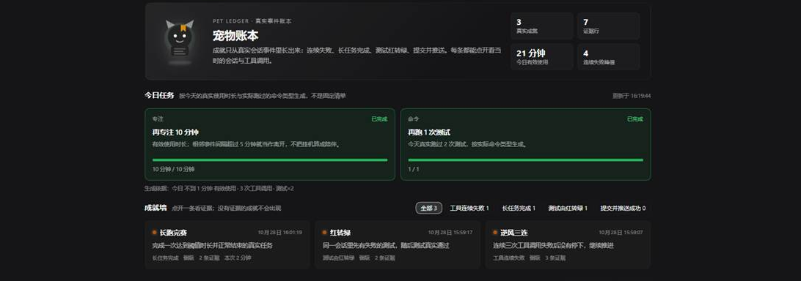
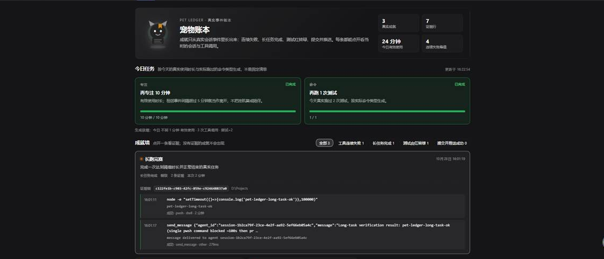
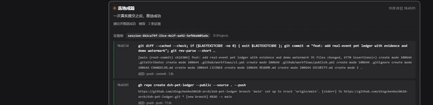
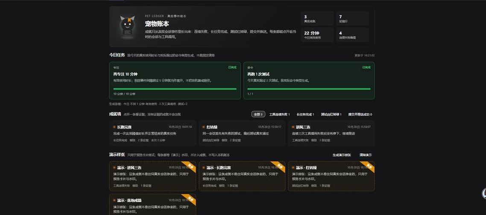

# dsh-pet-ledger

> 一只只认真实会话事件的宠物账本：连续失败、长任务完成、测试红转绿、提交并推送。
> 每条成就都能点开看当时的会话、命令与结果；演示卡片带「演示」水印，永远不会变成真实成就。

[](https://github.com/dingchenhui0618-arch/dsh-pet-ledger/actions/workflows/ci.yml)
[](LICENSE)



## 它解决什么问题

大多数「宠物 / 成就」插件靠插件内部计数器升级：点一下、过一天、开一次面板，数字就涨。
这种数字和真实工作没有关系，也无法核对。

`dsh-pet-ledger` 把成就的来源限定为 **DSH 真实事件总线**：

| 事件 | 它记录的事实 |
| --- | --- |
| `tools/pre-execute` | 某个工具调用即将发生；这里只做记录，永远继续 `next()`，不拦截工作 |
| `tools/result` | 调用真正结束：成功、失败、非零退出码、耗时、结果摘要 |
| `agent/status` | 一个 agent 从 `running` 到 `idle`，这是「真实任务时长」的起止 |
| `session/event` | `turn/end` 与结束原因；只有正常完成才可能拿到长任务成就 |
| `session/created` | 会话的 `cwd`，作为证据里的会话位置 |
| `agent/disposed` | 会话被回收时清掉它的运行时状态，避免旧 streak 串到新会话 |

客户端只渲染 host 折叠出来的快照，**不计算、不授予、不递增任何成就**。

## 四类成就，只有四类

| 系列 | 门槛 | 判定依据 |
| --- | --- | --- |
| 工具连续失败 | 3 / 6 / 10 次 | 同一会话内连续 `tools/result` 失败；成功一次就清零 |
| 长任务完成 | 1 / 3 / 10 次 | `agent/status` 从 `running` 到 `idle` 的时长 ≥ 阈值（默认 90 秒），且 `turn/end` 的 reason 是正常完成，不是中断/取消 |
| 测试由红转绿 | 1 / 3 / 8 次 | 同一会话里先有一个失败的测试命令，随后有测试命令真实通过；跨会话不算 |
| 提交并推送成功 | 1 / 5 / 15 次 | 同一会话里 `git commit` 成功之后，`git push` 成功；commit 失败会清掉标记，push 失败保留 commit 以便重试 |

没有「登录成就」「打开面板成就」「运行天数成就」，也没有手动点亮接口。
不是四类事件产生的记录，不会进入成就墙。

失败判定不是只看 `result.isError`：终端工具经常把非零退出码放在
`result.value.exitCode` / `exit_code` / `code` 里，或者只输出一行
`[exit code: N]`。这三种都算真实失败，否则「失败」会被静默漏掉。

## 每条成就都有证据链

点开任意一张成就卡，会展开：

- 触发它的 **会话 id** 与会话 `cwd`（能从 `sessions` 服务读到的话）；
- 每一次工具调用的 **时间、工具名、实际命令行 / 写入路径、结果摘要、耗时、成功或失败**；
- 长任务还会显示本次持续时长与结束原因；
- 没有工具调用的长任务会明确说明「时长与结束原因来自 `agent/status` 与 `session/event`」，
  而不是伪造一条命令。



证据行在 host 端生成并持久化；前端只负责展开/收起（`aria-expanded`），不会在点击时补造内容。

「提交并推送」同样要求两条真实证据：一条成功的 commit，一条成功的 push。
下图是首次公开仓库时留下的真实记录（commit `cb2d304`，`gh repo create ... --push`）：



## 今日任务不是固定清单

当天**第一次**满足「至少 60 秒有效使用或 3 次工具调用」时，生成一次任务，然后冻结：

1. **专注任务**：目标 = `clamp(向上取整到 5 分钟(max(60 秒, 今日有效使用 × 0.5)), 10 分钟, 60 分钟)`。
   相邻事件间隔超过 5 分钟按离开处理，挂机不计入有效使用。
2. **命令任务**：从当天真实跑过的命令类型里取前两种（测试、提交、推送、构建、安装、
   lint、运行、git、shell……），目标 = `clamp(ceil(实际次数 / 2), 1, 5)`，
   例如「再跑 1 次测试」。
3. 生成时记录 `baseline` 与 `basis`；之后进度相对冻结的 baseline 计算，目标不会随当天
   使用量上涨而漂移。
4. 真实活动不足时显示明确的 pending 原因，不凭空给任务。

命令分类是启发式的（`src/commands.js`）：`pip install pytest` 算安装而不是测试；
`gh repo create ... --push` 算推送；`node --test`、`vitest`、`pytest`、`cargo test` 等算测试。

## 演示水印

面板底部的「演示样张」区块可以生成 4 张演示卡，用于预览样式：

- 每张带橙色虚线边框与「演示」水印/角标；
- 明确不计入「真实成就」「证据行」「连续失败峰值」；
- 只存在 host 内存，**不写入** `pet-ledger.json`，刷新/重启就消失；
- 点「清除演示」立即移除；演示卡的证据区还会额外标注「演示态 · 不计入真实成就」。



上图上半部分是真实成就，下半部分是 4 张带「演示」水印的样张；两者在数据和视觉上都是分开的。

以上截图于 2026-10-28 在真实运行的本机 profile 中截取（3 条与 5 条真实成就的两个时刻 + 4 条演示样张），未做 UI 合成；
不同截图的「今日有效使用」会随时间变化，这是真实账本在增长，不是占位数据。

## 安装

要求 DSH `>=0.2.1-rc.2 <0.3.0`。插件是 host + client 双半，零运行时依赖。

从 GitHub 安装：

```bash
dsh plugin --profile <你的 profile> add github:dingchenhui0618-arch/dsh-pet-ledger
```

本机源码开发：

```bash
dsh plugin --profile <你的 profile> add file:D:\Projects\dsh-pet-ledger
```

装好后重启 DSH，在对话视图的 Tab 栏里出现「宠物账本」。桌面端也可以直接在插件市场/插件页安装，
profile 由应用自己管理。

## 配置

在 profile 的 `cordis.patch.yml` 里给 `dsh-pet-ledger` 加 `config`：

```yaml
- id: dsh-pet-ledger
  name: dsh-pet-ledger
  config:
    longTaskMs: 90000     # 长任务阈值，默认 90 秒
    idleGapMs: 300000     # 超过 5 分钟算离开，不计有效使用
    timeZone: Asia/Shanghai
    minActiveMs: 60000    # 生成今日任务所需的最少有效使用
    minToolCalls: 3       # 或至少这么多次工具调用
    dataPath: D:\somewhere\pet-ledger.json   # 默认 $DSH_HOME/pet-ledger.json
    enabled: true
```

`enabled: false` 时仍然加载插件，但不记录、不落盘；面板会显示已有账本（如果有），但不会继续增长。
`dshHome` 只用于测试与特殊部署，一般不用配。

## HTTP 接口

路由挂在 `/dsh-pet-ledger`（prefix）：

- `GET /dsh-pet-ledger/state`：当前快照（成就、证据、今日统计、任务、演示、数据文件路径）。
- `POST /dsh-pet-ledger/demo`：生成演示卡（仅内存）。
- `POST /dsh-pet-ledger/demo-clear`：清除演示卡。

请求体上限 64 KiB；没有鉴权，和 DSH Web 面板同源。它只读写本机账本文件，不发网络请求。

## 数据与隐私

- 账本默认写到 `$DSH_HOME/pet-ledger.json`，只在本机；没有遥测、没有上传。
- 保存用临时文件 + rename，失败会在 `capture.saveError` 里报告，不会让工具调用失败。
- 读取时损坏 / 非对象 / 数组 JSON 会回退为空账本并记录 `unreadable ledger`，不抛异常。
- 演示记录与运行时 streak 不持久化；只有真实成就、当天统计与已生成任务会落盘。
- 不读取会话正文，只取 `session.header.cwd` 与会话 id；证据里的命令来自工具调用参数和结果摘要。

## 边界与已知限制

1. 只认四类事件；其他行为（如「连续 10 天打开 DSH」）不会产生成就。这是设计目标，不是待办。
2. 长任务依赖 `agent/status` 的 `running`/`idle` 边界；如果宿主没有发出这两个事件，就不会有长任务成就。
3. 测试红转绿依赖命令分类；自定义测试命令（不在 `commands.js` 的测试正则里）可能不会被识别。
4. 失败 streak 按会话隔离；不同会话的失败不会拼成一条 streak。
5. 证据最多保留 8 行/条（`MAX_EVIDENCE`），超出后保留最近的关键行；这是为了账本可读与文件大小。
6. 面板数字来自 host 快照，轮询间隔 1.5 秒；不是 WebSocket 实时推送。
7. 演示卡只在内存，重启消失；这是刻意的，避免演示数据混入本机历史。

## 开发

```bash
node scripts/build.mjs     # src/ -> lib/，零依赖
node --test                # 70 个测试
```

`lib/` 是提交进仓库的构建产物（用户安装预构建包）；CI 会重建并确认 `lib/` 与 `src/` 一致。

结构：

```
src/host.js        host 半边：事件订阅、路由、持久化、单文件 owner 接管
src/ledger.js      纯 reducer：四类成就、证据、日统计、演示
src/quests.js      按真实使用生成并冻结今日任务
src/commands.js    命令/工具分类与证据行描述
src/store.js       原子读写、损坏回退、演示不落盘
src/client.cjs     对话视图「宠物账本」面板（CommonJS，React 由宿主提供）
src/client-css.cjs 主题 token CSS、水印、证据行、响应式
test/*.test.mjs    70 个测试
```

测试覆盖的关键行为：streak 成功即清零；红转绿必须同会话；失败 push 后 commit 可重试；
中断的长任务不算；演示永不计数/落盘；路由与监听器卸载；客户端水印与证据渲染；
host 重复挂载时接管文件而不是双计数。

## 与原始项目的差异

灵感来自 [sutera-diffusus/dsh-whale-musume](https://github.com/sutera-diffusus/dsh-whale-musume)
（MIT）。据其 README，它有 45 个成就、每日任务与每周签到，成就主要来自插件内部计数器。

本项目**没有克隆、fork 或复制它的代码**，是按 DSH 的事件契约独立实现的。具体差异：

| 维度 | 原始项目 | dsh-pet-ledger |
| --- | --- | --- |
| 成就来源 | 45 个成就，内部计数器/签到驱动 | 只有 4 个系列、12 个等级，全部来自真实会话事件 |
| 可核对性 | 卡片展示结果 | 每条成就可展开会话 + 工具调用证据 |
| 演示数据 | 无独立演示态 | 独立的演示数组，带「演示」水印，不计数、不落盘 |
| 每日任务 | 固定/预设任务 | 按当天有效使用与实际命令类型生成，生成后冻结 |
| 失败判定 | 主要看工具错误标志 | 同时识别 `isError`、非零退出码、`[exit code: N]` 文本 |
| 运行时状态 | 插件内部累计 | 显式的 host reducer + 事件订阅，可单测 |

原项目是 MIT；本项目没有复用其代码，因此不包含其版权声明。仅在此致谢灵感与产品方向。

## License

MIT。见 [LICENSE](LICENSE)。

## 安全

见 [SECURITY.md](SECURITY.md)：信任边界、账本数据流、路由能力、已知限制与报告渠道。
